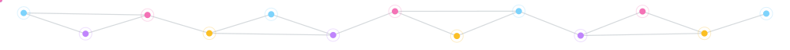
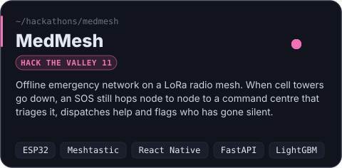
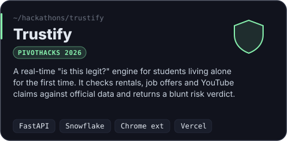
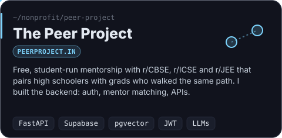
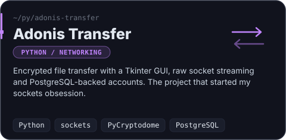

<div align="center">



</div>

<br/>

<p align="center">
  <b>Hey, I'm Shiven</b>, a quiet builder from the Himalayan foothills.<br/>
  I like software that keeps working when everything else stops:<br/>
  <i>SOS messages hopping over radio when the towers are down, models that read hands, backends that pair strangers who can help each other.</i>
</p>

<p align="center">
  
  
  
  
</p>



## `❯ cat now.md`

```diff
+ building   quantum-larpers. it's brand new and it's a secret (for now)
+ shipping   the peer project backend v2: graphql, smarter AI mentor matching, docker
+ hacking    whatever the next hackathon throws at me (last two: Hack the Valley 11, PivotHacks 2026)
- sleeping   pending...
```


## `❯ ls ~/projects --sort=love`

<p align="center">
  <a href="https://github.com/Ashmitbharti/MEDMESH-HTV"></a>
  <a href="https://github.com/Erenius-Valoraen/CrowdSolution"></a>
  <a href="https://github.com/ShyZen15/The-Peer-Project-Backend"></a>
  <a href="https://github.com/ShyZen15/Sign-Language-Model"></a>
  <a href="https://github.com/ShyZen15/Adonis-Transfer"></a>
  <a href="https://github.com/ShyZen15/dotfiles-better-v2"></a>
</p>

<details>
<summary><b>🔌 &nbsp;open the hardware drawer</b> &nbsp;<sub>(things with wires, sensors and questionable soldering)</sub></summary>
<br/>

| build | what it does |
|---|---|
| **MedMesh node** | Heltec WiFi LoRa 32 V3 boards running Meshtastic, plus an ESP32 SOS button you have to hold for 3 seconds (let go early and it cancels) |
| **EMF Detector** | An Arduino device that detects electromagnetic fields, with custom ML on top to make sense of the readings |
| **Driver Safety Device** | Hardware sensors and an ML model that watch a driver's alertness and step in before it becomes a crash |
| **Caristification** | An AI chatbot that suggests cars to fit your lifestyle and previews modifications before you make them |
| **Video Meeting App** | An accessible video-call platform designed for people of determination |

</details>


## `❯ cat stack.toml`

<table>
<tr>
<td width="160"><code>[languages]</code></td>
<td></td>
</tr>
<tr>
<td><code>[backend]</code></td>
<td></td>
</tr>
<tr>
<td><code>[frontend]</code></td>
<td></td>
</tr>
<tr>
<td><code>[ml.vision]</code></td>
<td> &nbsp;<sub>+ LightGBM · XGBoost · YOLOv8/11 · pgvector · Hugging Face</sub></td>
</tr>
<tr>
<td><code>[hardware]</code></td>
<td> &nbsp;<sub>+ ESP32 · LoRa · Meshtastic · sensors that occasionally catch fire</sub></td>
</tr>
<tr>
<td><code>[daily.driver]</code></td>
<td> &nbsp;<sub>+ Hyprland · Waybar · fish · starship · pywal</sub></td>
</tr>
</table>


## `❯ man shiven`

```text
SHIVEN(1)                       User Commands                       SHIVEN(1)

NAME
       shiven - turns caffeine, hackathon deadlines and LoRa packets into
                working software

SYNOPSIS
       shiven [--build] [--rice] [--ship-at-4am] <idea>

DESCRIPTION
       Writes Python first, asks questions later. Connects hardware to models
       to people. Will rewrite your dotfiles if left unattended.

OPTIONS
       --sockets      falls back to raw sockets whenever a library feels too
                      easy (see: adonis-transfer)
       --mesh         keeps messages moving when the network is down
       --mentor       matches students with people who walked the same path

BUGS
       Thinks "one more feature" before every deadline. Has never once been
       right about that.

SEE ALSO
       peerproject.in(1), devpost.com/software/medmesh(1)
```


## `❯ ping shiven`

<p align="center">
  <a href="https://github.com/ShyZen15"></a>
  <a href="https://peerproject.in"></a>
  <a href="https://devpost.com/software/medmesh"></a>
  <!-- add yours:
  <a href="https://linkedin.com/in/YOUR-HANDLE"></a>
  -->
</p>

<p align="center"><sub>open to hackathon teams, open-source collabs, and anything involving radios, models, or both.</sub></p>

<br/>

<div align="center">

</div>

<!-- every SVG in /assets is generated: edit assets/generate.py, then run `python3 assets/generate.py` -->
